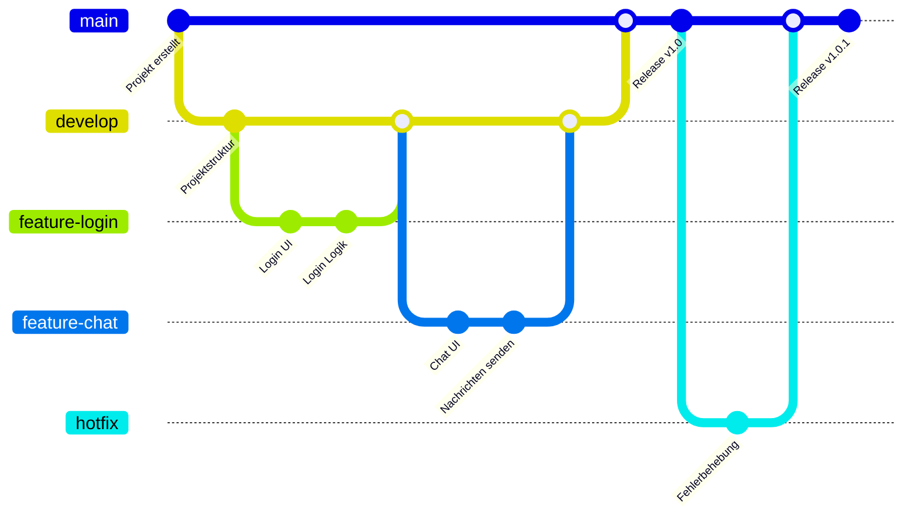

# Mein Projekt

Eine kurze Beschreibung des Projekts.

## Features

- Benutzeranmeldung
- Chat-Funktion
- Datenbankanbindung
- Responsive UI

## Voraussetzungen

- Git
- Python 3.12
- VS Code

## Installation

```bash
git clone https://github.com/benutzer/mein-projekt.git
cd mein-projekt
pip install -r requirements.txt
```

## Verwendung

```bash
python main.py
```

## Projektstruktur

```text
mein-projekt/
├── src/
│   ├── main.py
│   ├── database.py
│   └── ui.py
├── tests/
├── docs/
├── requirements.txt
└── README.md
```

## Git-Workflow



## Entwicklungsablauf

1. Feature-Branch erstellen
2. Änderungen entwickeln
3. Pull Request öffnen
4. Review durchführen
5. Merge in `develop`
6. Release nach `main`

## Screenshots

docs/login.png

## Lizenz

MIT License

## Autor

Jonas Schröder